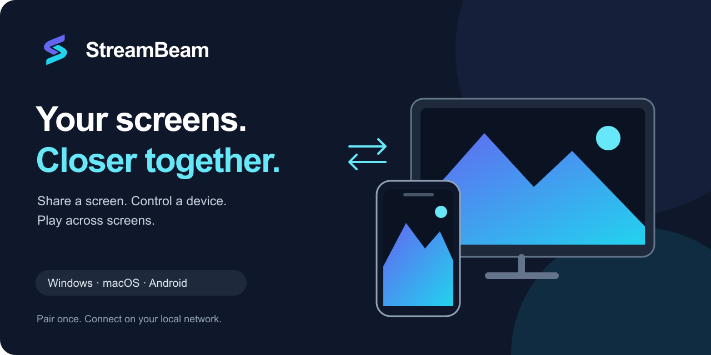

<p align="center">
  
</p>

<p align="center">
  <a href="https://github.com/joepio/streambeam/releases/tag/v0.1.0">Download Android preview</a> ·
  <a href="https://streambeam.eu">Website</a> ·
  <a href="docs/PLATFORMS.md">Platform support</a> ·
  <a href="docs/PROGRESS.md">Development status</a>
</p>

# Your screens, closer together

**StreamBeam shares screens, streams games and lets you control another device over your local network.** Watch your Mac on an Android phone, play from a Windows PC on a tablet, or share an Android screen with your desktop.

Windows, macOS and Android can send and receive video. The iPhone/iPad viewer is implemented and tested in the simulator; physical-device acceptance is still pending. Capabilities such as audio, remote input and hardware codecs vary by platform. StreamBeam is an early preview, with active development and real-device testing.

## Find a device. Pair once. Connect.

1. **Open StreamBeam on both devices**, connected to the same local network. Nearby devices appear automatically.
2. **Choose the device you want to watch.** Request a connection and approve it on that device, or pair using its QR code or link.
3. **Start streaming.** An approved device can reconnect without repeating pairing. Android asks you to confirm screen sharing for each new capture session.

On macOS, allow **Screen Recording** to share your screen and **Accessibility** for remote mouse and keyboard control. On Android, remote touch control requires the app's Accessibility service.

## What you can do

- **Share a desktop or phone screen.** The same app can watch another screen or share its own.
- **Play across devices.** Hardware video encoding and decoding where supported, adjustable quality, and gamepad forwarding to Windows hosts with VIIPER installed.
- **Control the remote device.** Mouse, keyboard and touch support depend on the sending and receiving platforms; see the [capability matrix](docs/PLATFORMS.md).
- **Connect directly.** Devices authenticate with pinned keys over encrypted QUIC connections. No account or cloud relay is required for local streaming.
- **Pair without configuration pages.** Nearby-device approval, QR codes and pairing links are built into the app.

## Availability

| Platform | Share its screen | Watch another screen | Install today |
|---|---|---|---|
| **Android** | Yes; system confirmation per capture session | Yes | [ARM64 preview APK](https://github.com/joepio/streambeam/releases/tag/v0.1.0), Android 8+ |
| **macOS** | Yes; Screen Recording permission required | Yes | Source / CI app bundles for Apple Silicon and Intel |
| **Windows** | Yes; desktop capture and optional background service | Yes; H.264 viewer implemented | Source / unsigned CI ZIP |
| **Linux** | Not implemented | Not implemented | Experimental CI shell bundle; no native streaming |
| **iOS / iPadOS** | Not available | Implemented: SDR H.264 and host audio; physical-device acceptance pending | Source / unsigned CI build; no installable store release |
| **Browser** | Not available | Experimental viewer with optional audio/control through a separate bridge | Local development only; not deployed |

**Preview limits:** CI bundles are build artifacts, not signed public installers. App Store, Google Play and Microsoft Store releases are not available yet. The iOS app record is registered as **StreamBeam Remote Desktop**, with no uploaded build; see [release status](docs/RELEASING.md). Audio is partially implemented and still needs broader device validation; Android screen sharing is video-only. The [experimental browser viewer](docs/WEB.md) requires a separately launched bridge; audio and remote input require session consent. Physical browser/desktop acceptance remains pending. Internet discovery, NAT traversal and relays are [future work](docs/WAN.md). There is no published end-to-end latency guarantee.

The published Android preview may lag behind current development. See [releases](https://github.com/joepio/streambeam/releases) for the exact downloadable build, and [PROGRESS](docs/PROGRESS.md) for recent changes.

## Continuous integration

CI builds Android ARM64, Windows x64, macOS Apple Silicon and Intel, an experimental Linux x64 shell, and an unsigned iOS app. The iOS workflow also tests real VideoToolbox decoding and audio-engine startup in a simulator. A separate browser workflow exercises the optional bridge and viewer against the streaming fixture.

A passing build does not establish device acceptance or store signing. Check the [workflow run for the exact commit](https://github.com/joepio/streambeam/actions); see [desktop delivery](docs/DESKTOP_RELEASES.md), [iOS validation](docs/IOS.md) and [store delivery](docs/RELEASING.md) for the remaining steps.

## Build and run

Use Flutter, the Rust toolchain pinned in `rust-toolchain.toml`, and the native SDK for your target platform. Android builds also need the Android NDK. See the [app development guide](app/README.md) and [Windows host setup](docs/SETUP_MANCAVE.md).

```sh
cd app
flutter pub get
flutter run -d macos      # or -d windows, or a connected Android device
```

After changing `app/rust/src/api/`, run `flutter_rust_bridge_codegen generate` from `app/`.

```sh
cargo test
cd app
flutter analyze --no-pub
flutter test --no-pub
```

For a local visual smoke test without a phone or real capture device, install FFmpeg and run:

```sh
cargo run -p streambeam-devtools --bin streamdemo
```

## How it works

A Flutter interface connects to a shared Rust core. Native capture and playback use ScreenCaptureKit / VideoToolbox on macOS, VideoToolbox playback on iOS, MediaProjection / MediaCodec on Android, and Windows capture / NVENC with a software H.264 fallback. H.264 is the common codec; AV1 is negotiated on supported hardware.

Video travels in QUIC datagrams with Reed–Solomon forward error correction. Reliable streams carry session control and input. Pairing pins Ed25519 identities; the host authorizes a viewer before sending media. QR pairing codes live in the URL fragment, which browsers do not send to the website server.

| Directory | Purpose |
|---|---|
| `app/` | Flutter app, Rust bridge and native platform integration |
| `crates/proto` | Wire types and media framing |
| `crates/net` | Transport, identities, pairing and discovery |
| `crates/core` | Client sessions, media recovery and input |
| `crates/host` | Capture, encoding and host session handling |
| `crates/svc` | Windows host service and worker lifecycle |
| `crates/devtools` | Fake host, test clients and streaming diagnostics |
| `site/` | Website, pairing-link landing page and experimental browser viewer |

[Protocol](docs/PROTOCOL.md) · [Debugging](docs/DEBUGGING_CLIENT.md) · [Release process](docs/RELEASING.md) · [Contributing conventions](AGENTS.md) · [Brand assets](assets/README.md)

Made by [Ontola](https://ontola.io).
