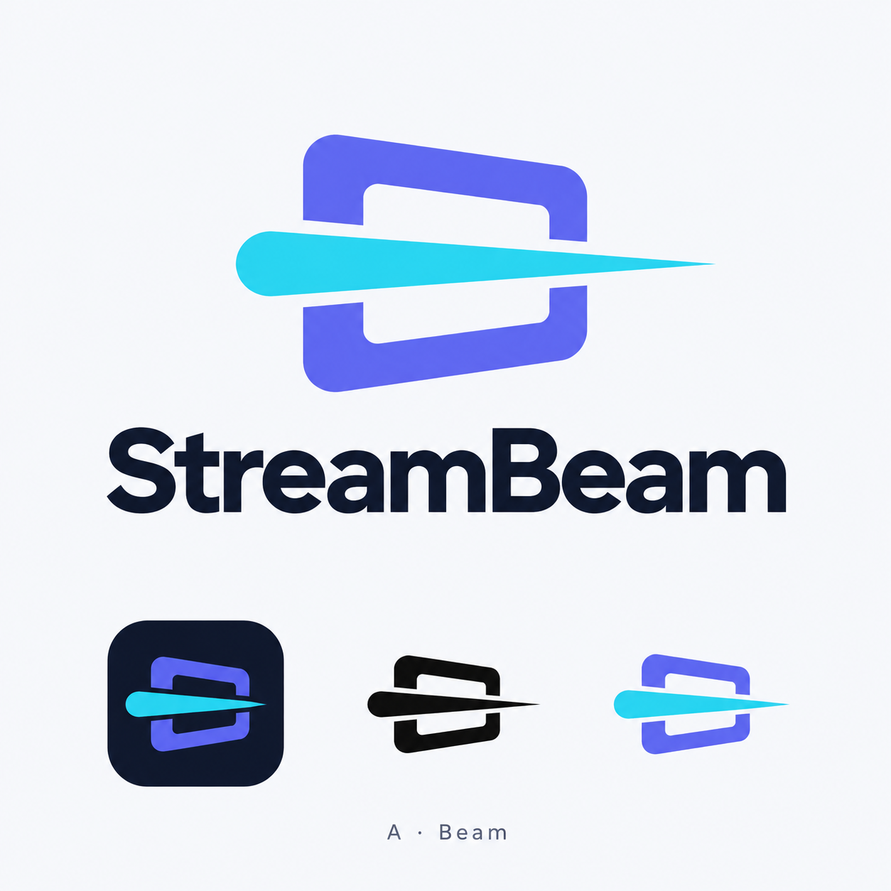
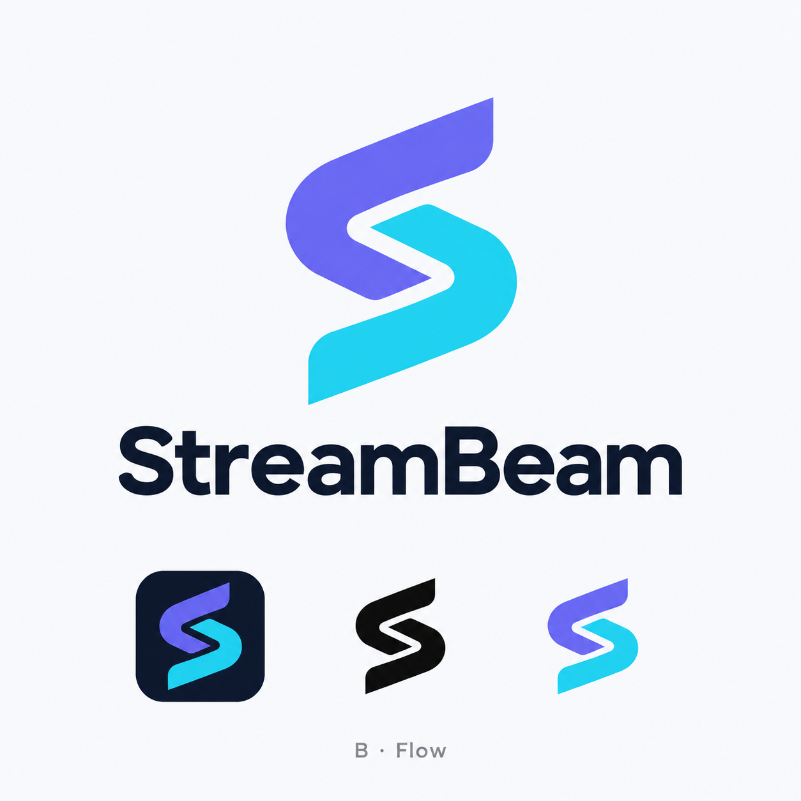
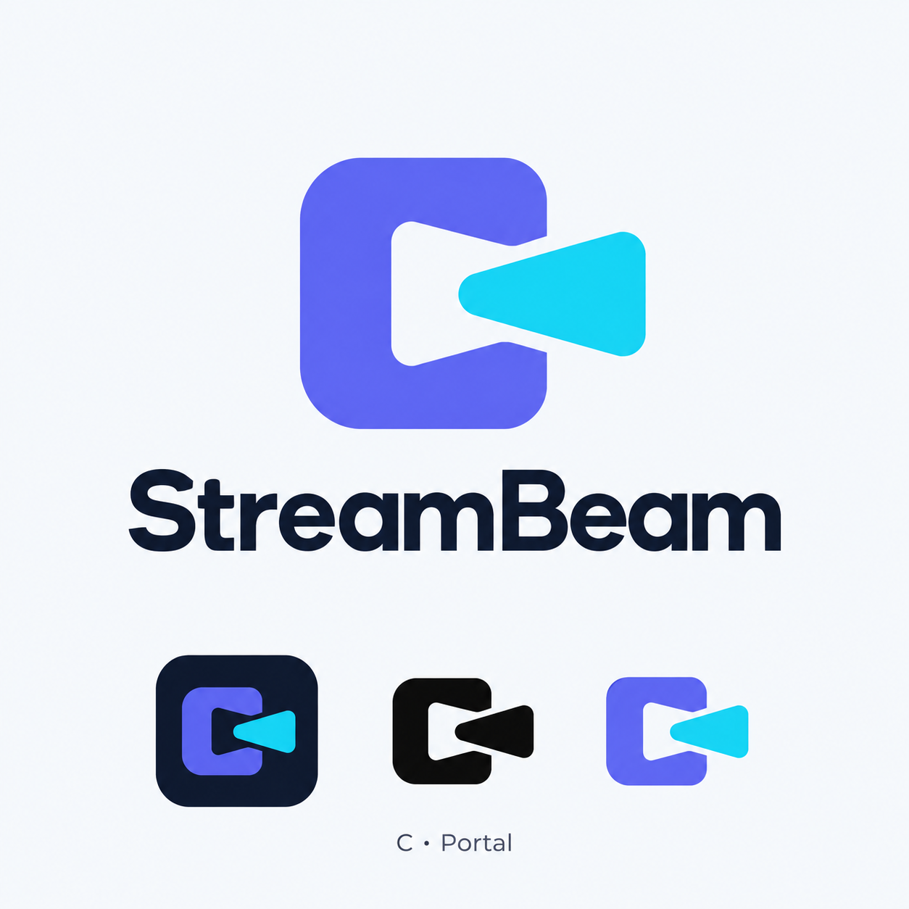
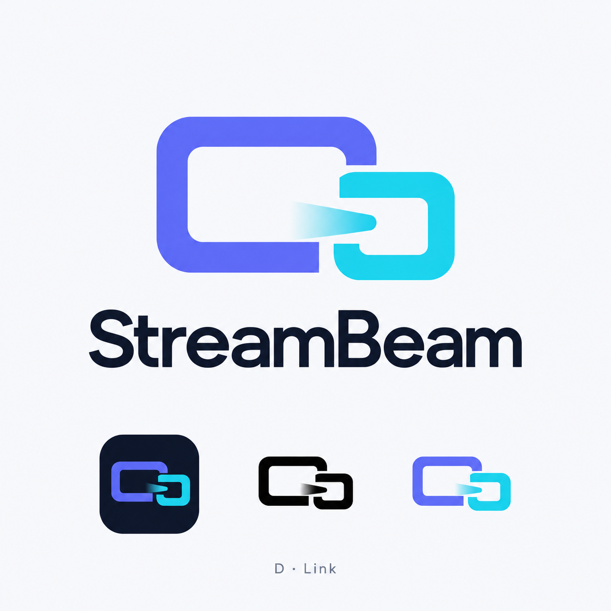

# StreamBeam logo explorations — 2026-10-11

Four concept boards generated with the built-in image generation tool. These are raster explorations, not final vector masters. Each shows a wordmark, app icon and monochrome treatment. Existing indigo/cyan/navy colors were retained for comparison. No production assets have been replaced.

- **A — Beam:** screen and fast horizontal beam.
- **B — Flow:** flowing S monogram. Recommended for its compact silhouette.
- **C — Portal:** rounded portal and projected beam.
- **D — Link:** linked desktop and smaller display.

## Exact prompts

### a-beam

Use case: logo-brand. Create a polished logo exploration presentation for StreamBeam, a fast low-latency app for streaming a PC's games and desktop to a phone or tablet. This is a new logo direction, not an edit. Flat, vector-friendly geometric design with a distinctive simple silhouette and large clean negative space, legible at app icon size. Use existing brand palette: deep navy #0F172A, indigo #6366F1 and cyan #22D3EE. No neon glow, no fine decorative lines, no 3D, no photography, no stock wifi symbol, no game controller, no watermark. Square presentation on a very light cool-gray background. Show one large primary mark centered above the exact wordmark "StreamBeam" in clean carefully spaced contemporary sans serif. Across the bottom show the SAME mark as three small practical applications: a navy rounded-square app icon, a black monochrome mark, and a small full color mark. All applications must use exactly the same shape. Add only the small concept label specified below, no other prose.
Concept label "A · Beam". Invent an elegant symbol of a single display frame intersected by one fast horizontal ray of light. Merge them into one simple compact iconic shape; the beam should read as fast projection of a screen, not a glowing UFO. Confident thick geometry, sharp controlled beam taper with softened screen corners. Indigo screen, cyan beam.

### b-flow

Use case: logo-brand. Create a polished logo exploration presentation for StreamBeam, a fast low-latency app for streaming a PC's games and desktop to a phone or tablet. This is a new logo direction, not an edit. Flat, vector-friendly geometric design with a distinctive simple silhouette and large clean negative space, legible at app icon size. Use existing brand palette: deep navy #0F172A, indigo #6366F1 and cyan #22D3EE. No neon glow, no fine decorative lines, no 3D, no photography, no stock wifi symbol, no game controller, no watermark. Square presentation on a very light cool-gray background. Show one large primary mark centered above the exact wordmark "StreamBeam" in clean carefully spaced contemporary sans serif. Across the bottom show the SAME mark as three small practical applications: a navy rounded-square app icon, a black monochrome mark, and a small full color mark. All applications must use exactly the same shape. Add only the small concept label specified below, no other prose.
Concept label "B · Flow". Invent a bold abstract S monogram using two interlocking ribbon-like geometric bands with a small clear separation, suggesting a continuous stream of data and motion. Flat indigo and cyan, no rendered ribbon shading. Compact, confident, smoothly radiused, neither a dollar sign nor an infinity symbol. Strong enough to be recognized in black silhouette.

### c-portal

Use case: logo-brand. Create a polished logo exploration presentation for StreamBeam, a fast low-latency app for streaming a PC's games and desktop to a phone or tablet. This is a new logo direction, not an edit. Flat, vector-friendly geometric design with a distinctive simple silhouette and large clean negative space, legible at app icon size. Use existing brand palette: deep navy #0F172A, indigo #6366F1 and cyan #22D3EE. No neon glow, no fine decorative lines, no 3D, no photography, no stock wifi symbol, no game controller, no watermark. Square presentation on a very light cool-gray background. Show one large primary mark centered above the exact wordmark "StreamBeam" in clean carefully spaced contemporary sans serif. Across the bottom show the SAME mark as three small practical applications: a navy rounded-square app icon, a black monochrome mark, and a small full color mark. All applications must use exactly the same shape. Add only the small concept label specified below, no other prose.
Concept label "C · Portal". Invent a bold rounded rectangular portal with a rightward play/beam shape emerging from its negative space. Integrate the opening and beam into one proprietary compact symbol. One indigo main body and one cyan exit accent. Elegant, friendly, effortlessly fast; strong negative space and confident silhouette. Avoid a generic standalone play triangle.

### d-link

Use case: logo-brand. Create a polished logo exploration presentation for StreamBeam, a fast low-latency app for streaming a PC's games and desktop to a phone or tablet. This is a new logo direction, not an edit. Flat, vector-friendly geometric design with a distinctive simple silhouette and large clean negative space, legible at app icon size. Use existing brand palette: deep navy #0F172A, indigo #6366F1 and cyan #22D3EE. No neon glow, no fine decorative lines, no 3D, no photography, no stock wifi symbol, no game controller, no watermark. Square presentation on a very light cool-gray background. Show one large primary mark centered above the exact wordmark "StreamBeam" in clean carefully spaced contemporary sans serif. Across the bottom show the SAME mark as three small practical applications: a navy rounded-square app icon, a black monochrome mark, and a small full color mark. All applications must use exactly the same shape. Add only the small concept label specified below, no other prose.
Concept label "D · Link". Invent a minimal iconic connection between one broad display and one smaller display, using two offset open rounded rectangular shapes that interlock into a unified compact mark. The shared gap between them becomes a subtle forward beam. Indigo and cyan. A clever flat graphic silhouette expressing effortless device-to-device streaming without cables, wifi arcs, arrows pasted on top, or tiny UI details.

